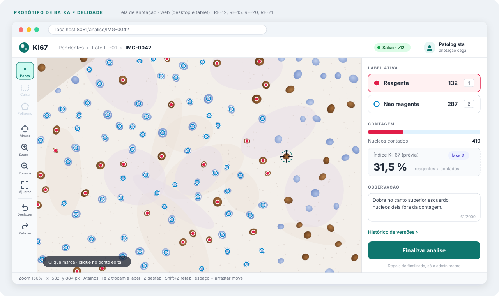
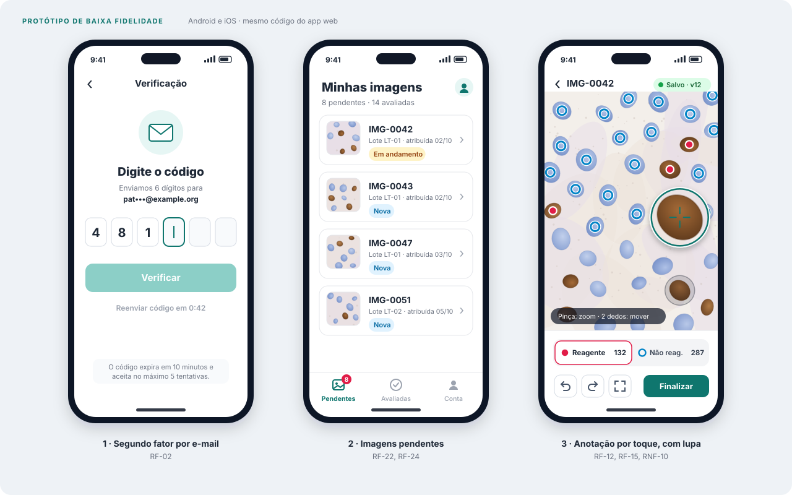
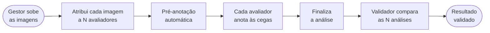

<div align="center">

# Ki67

**Anotação cega e versionada de imagens de imuno-histoquímica Ki-67, na web, no Android e no iOS, a partir de uma única base de código.**

[](docs/03-planejamento.md)
[](docs/01-visao-e-requisitos.md#7-requisitos-não-funcionais)
[](https://docs.expo.dev/versions/latest/)
[](https://www.typescriptlang.org/)
[](https://supabase.com/docs)
[](https://developers.cloudflare.com/r2/)
[](LICENSE)

[Visão e requisitos](docs/01-visao-e-requisitos.md) · [Arquitetura](docs/02-arquitetura.md) · [Planejamento](docs/03-planejamento.md) · [Guia de configuração](docs/04-guia-de-configuracao.md)

</div>

> [!NOTE]
> **MVP em teste.** O app (Segmenta Studio Ki-67 IHC) está implementado: banco com as regras de cegamento, versões e log, Edge Functions e todas as telas dos quatro papéis. Ele já roda em **modo demonstração**, sem nenhuma conta em nuvem. O teste com um projeto Supabase e um bucket R2 reais e nos celulares ainda está em andamento; a situação detalhada está em [03 · Planejamento](docs/03-planejamento.md#1-marcos-e-entregas). As imagens abaixo são os protótipos iniciais.

## O que é

O **Ki67** é uma plataforma para estudos com o marcador Ki-67. O gestor do projeto distribui imagens de lâminas a quantos avaliadores quiser, cada avaliador marca de forma independente e cega quais núcleos são reagentes (marrons) e quais não são (azul-claros), e um validador compara as análises da mesma imagem com métricas de concordância. Cada salvamento vira uma versão e cada ação entra num log que ninguém altera.

<p align="center">
  
</p>
<p align="center">
  
</p>
<p align="center"><sub>Protótipos de baixa fidelidade. Capturas reais e um GIF da anotação vão substituir estas imagens.</sub></p>

### Como funciona



Cada passo gera um registro no log de auditoria. O gestor define o N de cada lote (o padrão é 3).

| No MVP | Na fase 2 |
| --- | --- |
| Login com e-mail, senha e código enviado por e-mail (2FA) | Aba Em andamento |
| Usuários e papéis cadastrados pelo admin; projetos conduzidos por um gestor | Diff entre versões |
| Upload em lote, com hash SHA-256 de cada original e remoção de metadados | Versionamento das imagens |
| Anotação por pontos, caixas e polígonos, com zoom, pinça, lupa e desfazer | Labels configuráveis |
| Pré-marcação dos núcleos não reagentes e imagem já pré-anotada | Reabertura de análise finalizada |
| Índice Ki-67 calculado na tela | Modo offline completo |
| Comparação das N análises e métricas de concordância | |
| Cegamento garantido pelo banco (RLS), não só pela tela | |
| Salvamento automático, rascunho no aparelho, versões e histórico com restauração | |
| Log de auditoria que ninguém edita ou apaga | |
| Exportação no formato do Labelme e em CSV | |

## Stack

| Camada | Tecnologias e versões |
| --- | --- |
| App (web, Android e iOS) | Expo SDK 58 · React Native 0.88 · React 19.3 · React Native Web 0.21 · TypeScript 6.0 |
| Navegação e estilo | Expo Router 58 · NativeWind 4 (Tailwind CSS) |
| Estado | Zustand 5 (sessão, dados e editor) · TanStack Query 5 |
| Canvas e gestos | react-native-svg 15 · PanResponder do React Native |
| Armazenamento no aparelho | expo-secure-store (chave da sessão) · AsyncStorage (sessão cifrada e rascunho da análise) |
| Backend | Supabase: PostgreSQL 17 com RLS, triggers e funções RPC · Supabase Auth · Edge Functions (Deno) |
| Armazenamento de imagens | Cloudflare R2 (bucket privado, imagens enviadas e lidas por URL assinada) |
| E-mail do código 2FA | Resend (API HTTP) |
| Testes e qualidade | Jest 30 · jest-expo 58 · ESLint · testes do banco num PostgreSQL local |

O papel de cada biblioteca e o porquê de cada escolha estão em [02 · Arquitetura](docs/02-arquitetura.md#11-bibliotecas-e-o-papel-de-cada-uma).

## Como rodar do zero

### Pré-requisitos

| Ferramenta | Versão | Para quê |
| --- | --- | --- |
| [Git](https://git-scm.com/) | 2.40 ou mais nova | Clonar o repositório |
| [Node.js](https://nodejs.org/) | 24 LTS | App e ferramentas |
| [Expo Go](https://expo.dev/go) | Versão atual da Play Store ou da App Store | Rodar no celular sem gerar build |
| Android Studio ou Xcode *(opcional)* | — | Emulador Android ou simulador iOS (Xcode só no macOS) |

### Modo demonstração (sem nenhuma conta)

```bash
git clone https://github.com/Matheus-Lordron/ki67.git
```

```bash
cd ki67
```

```bash
npm install
```

```bash
npm run dev:web
```

Abra <http://localhost:8081>. Sem o arquivo `apps/mobile/.env`, o app entra em **modo demonstração**: os botões abaixo do login preenchem uma conta de cada papel, qualquer código de 6 dígitos passa no 2FA e os dados ficam só na memória (somem ao recarregar a página).

- **Android:** `npm run dev:android` com o emulador aberto, ou `npm run dev:app` e escaneie o QR code com o Expo Go.
- **iOS:** `npm run dev:app` e escaneie o QR code com a câmera do iPhone.

### Modo real (Supabase + R2)

O passo a passo completo, com o SQL do banco, o bucket do R2, o e-mail do código 2FA e o deploy das Edge Functions, está em [04 · Guia de configuração](docs/04-guia-de-configuracao.md). Em resumo:

1. Crie o projeto no Supabase e rode `supabase/schema.sql` no SQL Editor.
2. Crie o bucket privado no R2, com a política de CORS do guia.
3. Configure os segredos e implante as funções de `supabase/functions/`.
4. Copie `apps/mobile/.env.example` para `apps/mobile/.env`, preencha a URL e a chave **pública** do Supabase e rode `npm run dev:web` de novo.

> [!IMPORTANT]
> O `.env` nunca vai para o Git. A chave `service_role` e as credenciais do R2 ficam só nos segredos das Edge Functions, nunca no `.env` do app.

### Scripts

Todos rodam na pasta `ki67`.

| Comando | O que faz |
| --- | --- |
| `npm run dev:web` | Abre o app no navegador, em http://localhost:8081 |
| `npm run dev:app` | Inicia o Expo (Metro) e mostra o QR code para o Expo Go |
| `npm run dev:android` | Abre o app no emulador Android |
| `npm test` | Testes do índice Ki-67, da limpeza de metadados e da pré-anotação |
| `npm run typecheck` | Checagem de tipos do TypeScript |
| `npm run lint` | ESLint |

### Problemas comuns

| Sintoma | Solução |
| --- | --- |
| O app abre em modo demonstração mesmo com o `.env` | O arquivo precisa estar em `apps/mobile/.env`. Pare o Expo e rode `npm run dev:web` de novo |
| A tela `/diagnostico` diz que o schema não foi aplicado | Rode `supabase/schema.sql` inteiro no SQL Editor do Supabase |
| O código 2FA não chega | Sem domínio verificado, o Resend só envia para o e-mail da própria conta. Só em desenvolvimento: deixe `RESEND_API_KEY` vazia, use `DEV_LOG_2FA_CODE=true` e leia o código em Supabase > Edge Functions > Logs |
| A imagem não abre ou o upload falha com erro de CORS | Confira a política de CORS do bucket no R2 e se a origem do app está em `APP_ORIGINS` |
| "Project is incompatible with this version of Expo Go" | Atualize o Expo Go: o projeto usa o SDK 58 |
| Uma mudança no código não aparece no navegador | Recarregue a página. Se continuar, pare o Expo e rode `npx expo start --clear` em `apps/mobile` |

## Estrutura do repositório

```text
ki67/
├── README.md                     ← você está aqui
├── LICENSE                       ← MIT
├── package.json                  ← scripts da raiz
├── apps/mobile/                  ← app Expo: web, Android e iOS
│   ├── src/app/                  ← telas (rotas do Expo Router)
│   ├── src/features/             ← anotação, validação, gestor, auditoria e sessão
│   ├── src/data/ e src/services/ ← acesso ao Supabase e ao R2
│   └── .env.example              ← URL e chave pública do Supabase
├── supabase/
│   ├── schema.sql                ← banco completo: tabelas, RLS, triggers e RPCs
│   ├── patch_fase4.sql           ← atualização para quem rodou a versão anterior
│   ├── bootstrap_admin.sql       ← cria o primeiro admin
│   └── functions/                ← Edge Functions: login, 2FA, usuários e R2
└── docs/
    ├── 01-visao-e-requisitos.md  ← problema, RF, RNF, critérios e escopo
    ├── 02-arquitetura.md         ← camadas, navegação, sequências e dados
    ├── 03-planejamento.md        ← cronograma, situação, branches e commits
    ├── 04-guia-de-configuracao.md ← Supabase, R2, e-mail e app, passo a passo
    └── img/                      ← protótipos e, depois, capturas reais
```

O que mora em cada pasta, e onde mexer para alterar cada coisa, está em [02 · Arquitetura](docs/02-arquitetura.md#4-estrutura-de-pastas).

## Documentação

| Documento | O que responde |
| --- | --- |
| [01 · Visão e requisitos](docs/01-visao-e-requisitos.md) | Que problema resolvemos e para quem; requisitos funcionais e não funcionais, cada um com critério de aceitação; privacidade e LGPD; o que fica fora do escopo |
| [02 · Arquitetura](docs/02-arquitetura.md) | Onde mexer para alterar cada coisa: camadas, mapa de navegação, diagramas de sequência, modelo de dados, RPCs, Edge Functions, decisões e limitações |
| [03 · Planejamento](docs/03-planejamento.md) | Cronograma até o Laboratório de Avaliação, situação atual, branches (uma por integrante), convenção de commits e Definition of Done |
| [04 · Guia de configuração](docs/04-guia-de-configuracao.md) | Como ligar o modo real: Supabase, Cloudflare R2, e-mail do código 2FA, Edge Functions e o app |
| [05 · Plano de refatoração](docs/05-plano-de-refatoracao.md) | O que muda depois do MVP e em que ordem: diagnóstico de segurança e LGPD, testes primeiro, separação entre frontend e backend, e o teste de cada tarefa |
| [06 · Plano de execução](docs/06-plano-de-execucao.md) | Em que ordem a refatoração acontece: regras de negócio consolidadas, frentes de trabalho, ondas até o Laboratório, linha de corte e o que depende de autorização |

**Para contribuir:** trabalhe na sua branch pessoal, atualizada com a `main`, escreva commits no padrão Conventional Commits e abra um pull request para a `main` com a documentação atualizada. As regras completas estão em [03 · Planejamento](docs/03-planejamento.md#4-estratégia-de-branches).

## Equipe

Matheus Lordron · Fernando Camiran · Kiria Nakahati · Guilherme Ishida · Henrique Iha

Projeto da disciplina COM1045, com o Prof. Jandrei Sartori Spancerski, no curso de Ciência da Computação da UTFPR, câmpus Medianeira, em 2026/2.

## Licença

Distribuído sob a licença [MIT](LICENSE); a escolha está justificada em [03 · Planejamento](docs/03-planejamento.md#8-licença). A licença cobre só o código-fonte: imagens de lâminas e anotações são dados de pesquisa, não ficam no repositório e seguem o protocolo do estudo.
