# 02 · Arquitetura

> **Documento vivo.** Versão 0.4, de 19/10/2026. Ele responde a uma pergunta: **onde eu mexo para alterar isto?** Os requisitos citados (RF, RNF) estão em [01 · Visão e requisitos](01-visao-e-requisitos.md). Esta versão descreve o que está implementado: o app fala direto com o Supabase e as regras de negócio ficam no banco ([D3](#12-decisões-de-arquitetura)).

**Neste documento:** [1. Visão geral](#1-visão-geral) · [2. Camadas do app](#2-camadas-do-app) · [3. Camadas do backend](#3-camadas-do-backend) · [4. Pastas](#4-estrutura-de-pastas) · [5. Navegação](#5-mapa-de-navegação) · [6. Sequências](#6-fluxos-principais) · [7. Ciclos de vida](#7-ciclos-de-vida) · [8. Dados](#8-modelo-de-dados) · [9. RPCs e Edge Functions](#9-rpcs-e-edge-functions) · [10. Segurança](#10-segurança-e-cegamento) · [11. Bibliotecas](#11-bibliotecas-e-o-papel-de-cada-uma) · [12. Decisões](#12-decisões-de-arquitetura)

---

## 1. Visão geral

Um único app Expo roda na web, no Android e no iOS. Administrador, gestor, avaliador e validador usam o mesmo app: o que muda entre eles são as telas e o que o banco deixa cada um ver.

Não há API própria. O app fala com o **Supabase** de três formas:

- **Supabase Auth** confere e-mail e senha e emite a sessão (JWT).
- **PostgREST** dá acesso às tabelas e às funções RPC, sempre filtrado pelo **RLS** (Row Level Security).
- **Edge Functions** cuidam do que precisa de segredo: o código 2FA por e-mail, o cadastro de usuários e as URLs assinadas do R2.

As regras de cegamento, versionamento e log ficam no próprio PostgreSQL, em políticas RLS, triggers e funções `SECURITY DEFINER` ([D3](#12-decisões-de-arquitetura)). As imagens ficam num bucket privado do **Cloudflare R2** ([D7](#12-decisões-de-arquitetura)). O app só conhece a chave pública (*publishable*) do Supabase e nenhuma chave do R2.

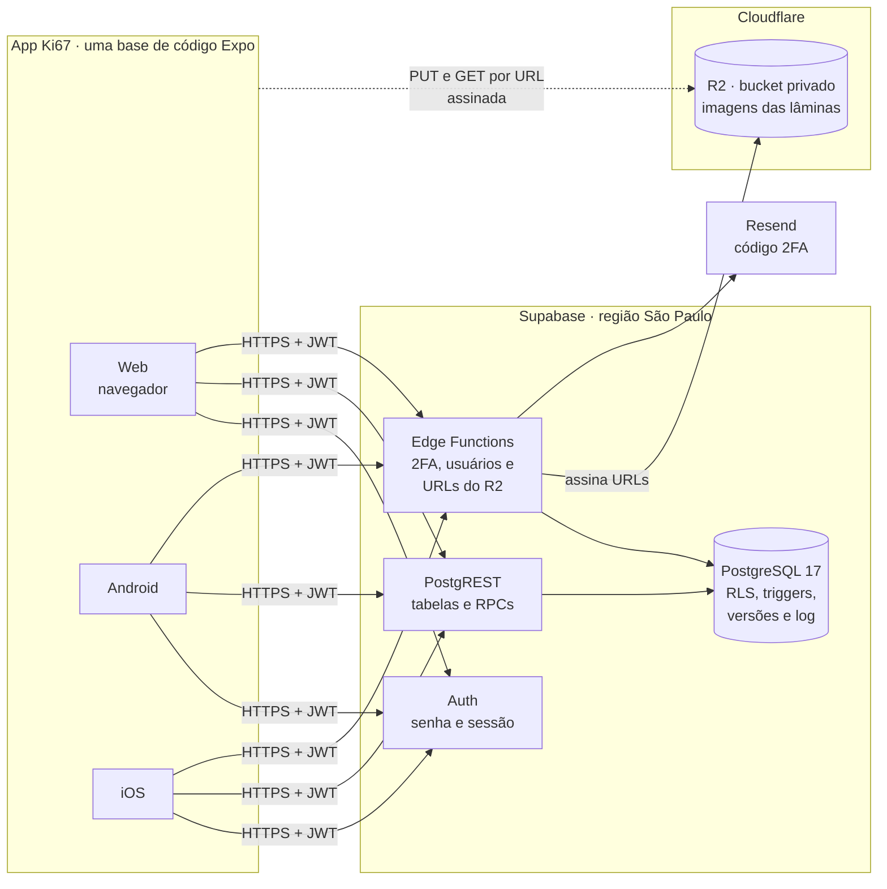

Sem o arquivo `apps/mobile/.env`, o app abre em **modo demonstração**: os mesmos fluxos, com dados em memória (`src/data/mockData.ts`). Isso permite mostrar e testar as telas sem nenhuma conta em nuvem. O passo a passo para ligar o modo real está em [04 · Guia de configuração](04-guia-de-configuracao.md).

## 2. Camadas do app

Cada camada fala só com a vizinha. **A tela nunca chama o Supabase diretamente**: ela usa o estado, que usa os dados e os serviços.

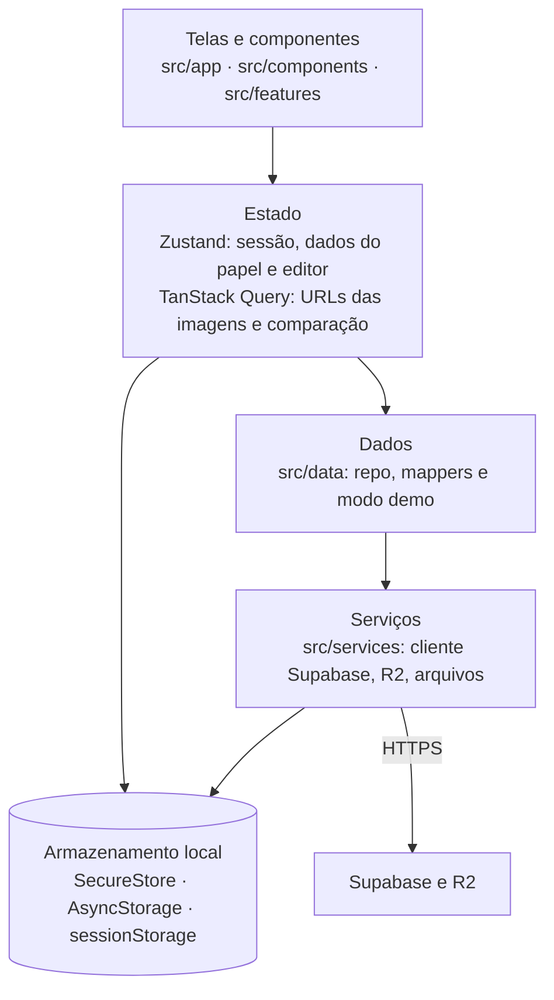

| Camada | Onde fica | Responsabilidade | Regra |
| --- | --- | --- | --- |
| Telas e componentes | `src/app/`, `src/components/`, `src/features/` | Desenhar a interface e capturar toques, cliques, teclas e gestos | Não conhece tabela, RPC nem URL |
| Navegação | `src/app/_layout.tsx`, grupos `(auth)` e `(app)` | Rotas, abas por papel, guarda de sessão e logout por inatividade | A guarda de rota é conveniência; quem bloqueia de verdade é o RLS (RF-28) |
| Estado | `src/state/appStore.ts` e `src/state/editorStore.ts` (Zustand) | Sessão, papel ativo, dados do papel, editor (marcações, ferramenta, desfazer e refazer, rascunho e conflito) | Fonte única da verdade para as telas |
| Dados | `src/data/` | `repo.ts` faz as consultas e RPCs; `mappers.ts` converte as linhas do banco para os tipos do app; `mode.ts` escolhe entre modo real e demonstração | As telas usam os mesmos tipos nos dois modos |
| Serviços | `src/services/` | Cliente Supabase com tratamento de erro, chamadas às Edge Functions, upload ao R2, leitura de arquivos e download | Única camada que faz rede |
| Armazenamento local | `src/storage/` | Sessão (cifrada no celular) e rascunho da análise aberta | Nunca guarda imagem nem dado de outro usuário |

## 3. Camadas do backend

O backend é o próprio projeto Supabase. Cada regra mora num lugar só:

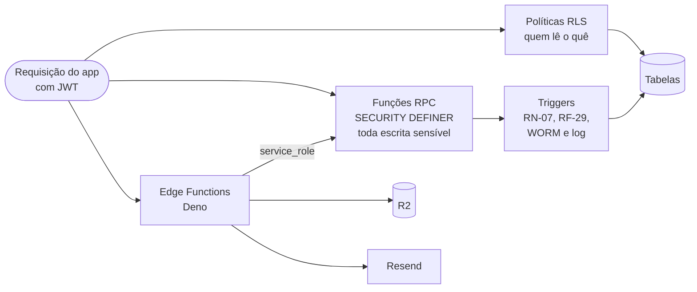

| Peça | Onde | O que faz | Requisitos |
| --- | --- | --- | --- |
| Políticas RLS | `supabase/schema.sql`, seção 9 | Cada papel só lê o que pode: o avaliador, as próprias análises; o gestor, os próprios projetos; o validador, só imagens prontas que ele não anotou. Sem 2FA confirmado na sessão, nada é liberado | RF-26 a RF-28, RN-08 |
| Funções RPC | `supabase/schema.sql`, seção 7 | Salvar, finalizar e restaurar versões, atribuir, registrar upload, abrir comparação e validar. O app não tem `INSERT` nem `UPDATE` direto nessas tabelas | RF-10, RF-21, RF-30 a RF-34 |
| Triggers | `supabase/schema.sql`, seções 5 e 6 | Gestor não avalia no próprio projeto (RN-07), N avaliadores por imagem (RF-29), transições de status, versões e log imutáveis, bloqueio de exclusão | RF-33, RF-38, RN-06 |
| Log com hash encadeado | trigger `audit_logs_chain` | Cada registro guarda o hash do anterior; `verify_audit_chain()` aponta qualquer quebra | RF-37, RF-38 |
| Edge Functions | `supabase/functions/` | Login com limite de tentativas e envio do código 2FA, criação de usuários pelo admin e URLs assinadas do R2 | RF-01, RF-02, RF-04, RF-08, RNF-06 |

## 4. Estrutura de pastas

```text
ki67/
├── .github/
│   ├── workflows/ci.yml              # CI: versões do Expo, lint, tipos, testes, build web, gitleaks, npm audit e commitlint
│   ├── dependabot.yml                # atualizações semanais agrupadas (npm e Actions)
│   ├── pull_request_template.md      # checklist da Definition of Done em todo PR
│   ├── CODEOWNERS                    # quem é chamado para revisar cada pasta
│   └── tests/                        # testes da configuração do commitlint
├── commitlint.config.mjs             # regras das mensagens de commit (docs/03, seção 5)
├── apps/
│   └── mobile/                       # app Expo: web, Android e iOS
│       ├── src/
│       │   ├── app/                  # rotas do Expo Router (cada arquivo é uma tela)
│       │   │   ├── _layout.tsx       # fontes, sessão, rede e provedores
│       │   │   ├── (auth)/           # login, código 2FA, esqueci e redefinir senha
│       │   │   └── (app)/            # telas logadas, com guarda e logout por inatividade
│       │   │       ├── avaliador/    # fila, anotação e análise finalizada
│       │   │       ├── validador/    # fila e comparação cega
│       │   │       ├── gestor/       # painel, lotes, atribuição, exportação e auditoria
│       │   │       └── admin/        # usuários, projetos e log global
│       │   ├── components/           # botões, cards, campos, tabelas, diálogos, cabeçalho
│       │   ├── features/
│       │   │   ├── anotacao/         # canvas SVG, gestos, lupa, pré-anotação, histórico
│       │   │   ├── validacao/        # fila e métricas da comparação
│       │   │   ├── gestor/           # escolha do projeto
│       │   │   ├── auditoria/        # tabela e filtros do log
│       │   │   └── sessao/           # logout por inatividade e recarga ao focar a tela
│       │   ├── state/                # stores Zustand (app e editor)
│       │   ├── data/                 # repo (consultas e RPCs), mappers, modo demo
│       │   ├── services/             # cliente Supabase, R2, arquivos, download
│       │   ├── storage/              # sessão e rascunho local
│       │   ├── utils/                # índice Ki-67, concordância, Labelme/CSV, metadados
│       │   ├── types/                # tipos do app e das linhas do banco
│       │   └── theme/                # cores e fontes
│       └── .env.example              # URL e chave pública do Supabase
├── supabase/
│   ├── schema.sql                    # banco completo: tabelas, RLS, triggers e RPCs
│   ├── patch_fase4.sql               # atualização para quem rodou o schema da Fase 1
│   ├── patch_idempotencia.sql        # request_id: clique duplo não cria projeto ou lote repetido
│   ├── tests/database/               # testes pgTAP (npx supabase test db, com Docker)
│   ├── bootstrap_admin.sql           # transforma uma conta em admin
│   ├── config.toml                   # configuração do Supabase CLI e das funções
│   └── functions/                    # Edge Functions (Deno) e o .env.example delas
├── docs/                             # esta documentação
└── package.json                      # scripts da raiz (delegam para apps/mobile)
```

### Onde eu mexo para alterar isto?

| Quero alterar... | Mexo em... |
| --- | --- |
| Uma tela ou a navegação | `apps/mobile/src/app/` (cada arquivo é uma rota) e as abas em `src/components/layout/TopHeader.tsx` |
| Um componente visual reutilizável | `apps/mobile/src/components/ui/` |
| O desenho, os gestos ou as ferramentas do canvas (ponto, caixa, polígono, lupa) | `apps/mobile/src/features/anotacao/` |
| Uma consulta ao banco ou chamada de RPC | `apps/mobile/src/data/repo.ts` (a tela nunca chama o Supabase direto) |
| Como uma linha do banco vira tipo do app | `apps/mobile/src/data/mappers.ts` |
| O que fica salvo no aparelho | `apps/mobile/src/storage/` |
| Cores e fontes | `apps/mobile/tailwind.config.js` e `apps/mobile/src/theme/` |
| Uma regra de negócio (quem pode ver ou fazer o quê) | `supabase/schema.sql`: a política RLS da tabela ou a função RPC da ação |
| O limiar de cor da pré-anotação | `THRESHOLDS` em `apps/mobile/src/features/anotacao/colorThreshold.ts` |
| Uma tabela ou coluna | `supabase/schema.sql` e um arquivo de atualização novo, como o `patch_fase4.sql`, para quem já rodou o schema |
| O índice, a concordância ou o formato Labelme/CSV | `apps/mobile/src/utils/ki67.ts` |
| Login, 2FA, cadastro de usuário ou URLs do R2 | `supabase/functions/<nome-da-função>/index.ts` |
| Uma variável de ambiente | `apps/mobile/.env.example` (app) ou `supabase/functions/.env.example` (funções), com comentário explicando o valor |

## 5. Mapa de navegação

As telas se agrupam como no Expo Router: uma pilha de autenticação e um grupo por papel. A seta pontilhada é a saída por logout ou por 30 min sem atividade, que vale para qualquer tela logada; telas com borda tracejada entram na fase 2.

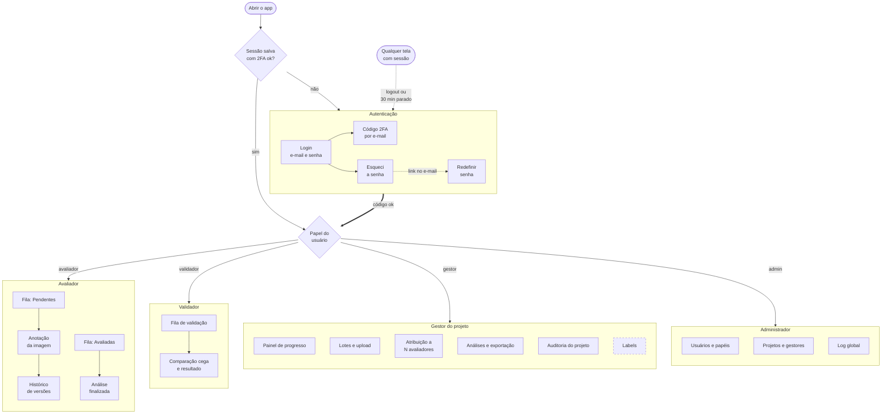

Quem tem mais de um papel troca de perfil pelo seletor do cabeçalho, sem novo login.

## 6. Fluxos principais

Os diagramas mostram quem fala com quem e em que ordem, **incluindo os caminhos de erro**.

### 6.1 Login com segundo fator por e-mail (RF-01, RF-02, RF-37)

O Supabase Auth confere a senha, mas a sessão que ele emite **não libera nenhum dado** até o código ser confirmado: as políticas RLS exigem um desafio 2FA verificado para aquela sessão (`session_id` do JWT).

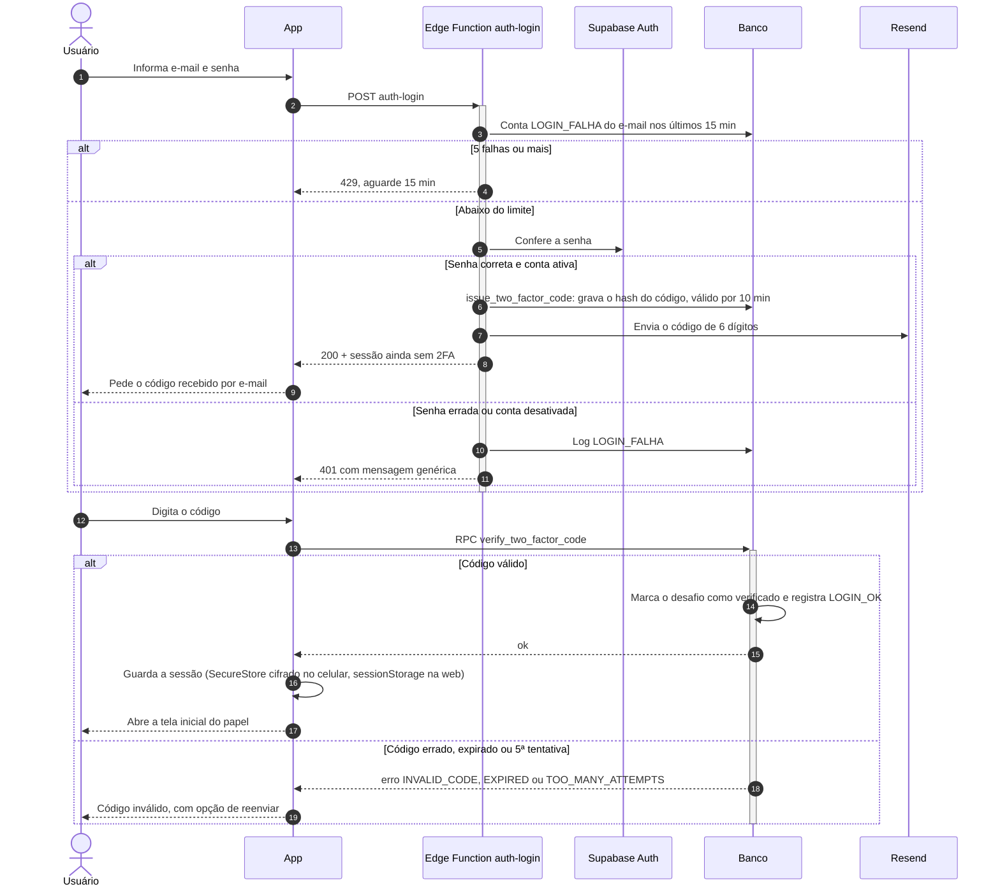

A recuperação de senha usa o e-mail do próprio Supabase Auth: o link abre `/redefinir-senha`, que troca a senha e encerra as sessões em todos os aparelhos.

### 6.2 Upload de imagens pelo gestor, com pré-anotação (RF-08, RF-11, RF-17, RF-18)

O arquivo vai do aparelho direto para o R2, sem passar pelo Supabase. A pré-anotação é calculada uma única vez, no upload, e guardada na versão da imagem, para todos os avaliadores receberem a mesma sugestão ([D10](#12-decisões-de-arquitetura)).

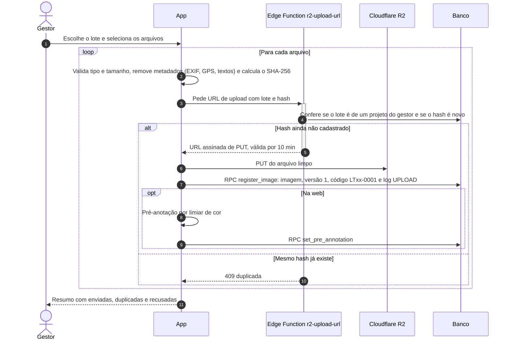

### 6.3 Abrir uma imagem atribuída: cegamento e URL assinada (RF-18, RF-27, RF-28, RNF-06)

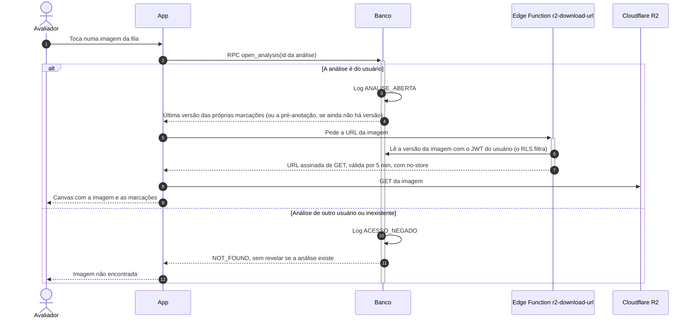

### 6.4 Salvar e finalizar a análise: versionamento sem perda (RF-21, RF-33, RNF-05)

```mermaid
sequenceDiagram
    autonumber
    actor A as Avaliador
    participant App
    participant Local as Rascunho local
    participant DB as Banco

    A->>App: Marca, corrige ou remove pontos, caixas e polígonos
    App->>Local: Grava o rascunho 0,4 s depois de cada alteração
    Note over App,Local: Autosave dispara 5 s depois da última alteração
    break Sem conexão
        App-->>A: Indicador Offline; o rascunho fica no aparelho e é retomado ao reabrir
    end
    App->>+DB: RPC save_analysis_version com marcações e versão base
    alt Versão base é a mais recente
        DB->>DB: Nova versão imutável com autor, dispositivo e hash do conteúdo, e log ANALISE_SALVA
        DB-->>App: Número da versão
        App->>Local: Descarta o rascunho já salvo
        App-->>A: Indicador Salvo · v12
    else Outro aparelho salvou antes
        DB-->>App: VERSION_CONFLICT
        App-->>A: Pergunta se mantém a sua versão ou a do servidor
    end
    deactivate DB

    A->>App: Toca em Finalizar análise e confirma
    App->>+DB: RPC finalize_analysis
    DB->>DB: Versão de finalização, status finalizada e log
    DB->>DB: Se era a última das N, imagem pronta para validação
    DB-->>App: ok
    deactivate DB
    App-->>A: A imagem sai de Pendentes e vai para Avaliadas
```

### 6.5 Comparação das análises e resultado (RF-30, RF-31, RF-32, RN-05, RN-08)

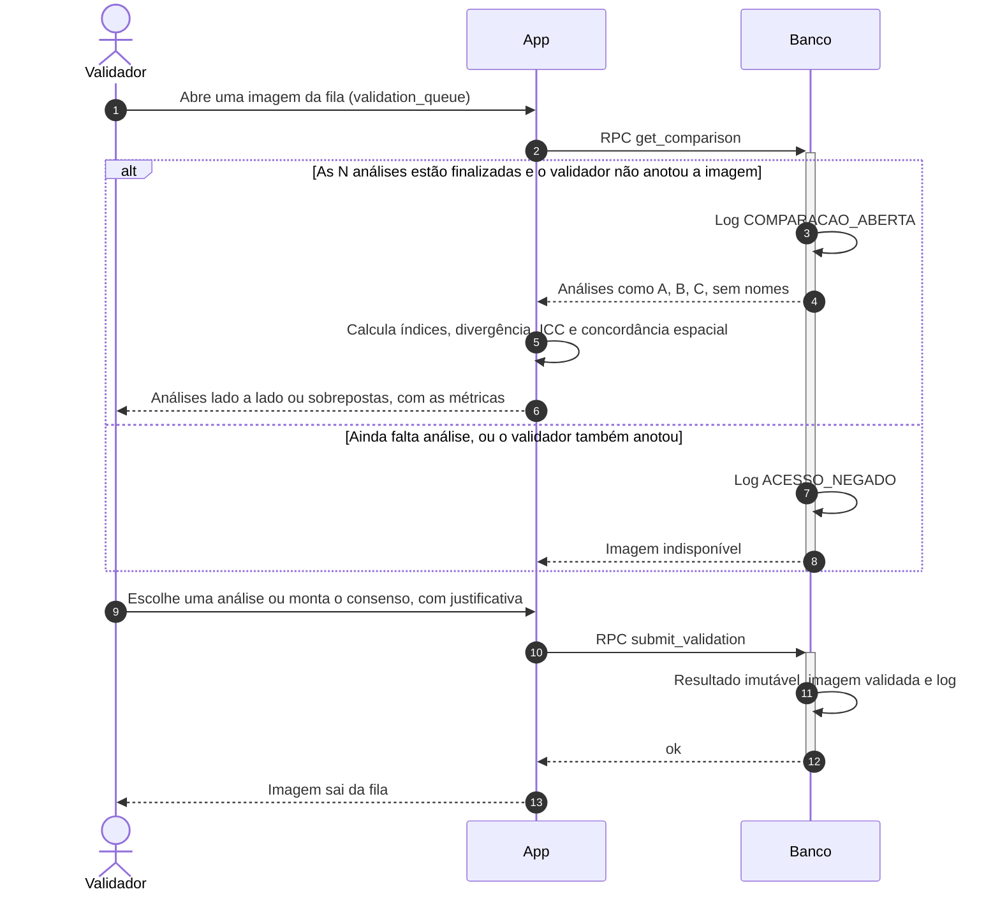

## 7. Ciclos de vida

Uma **análise** (o trabalho de um avaliador sobre uma imagem) passa por três estados:

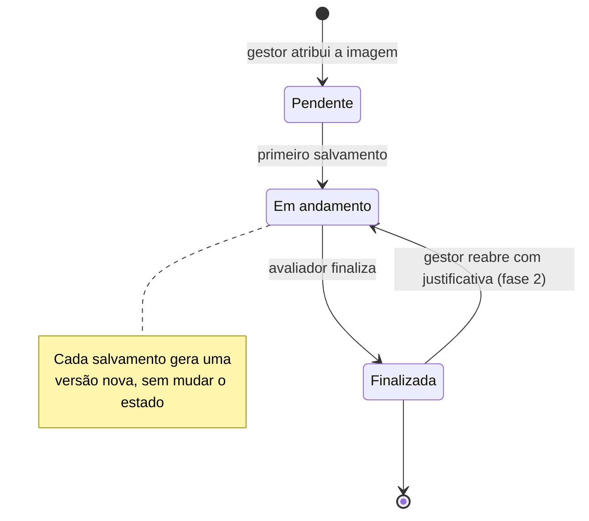

Uma **imagem** de um lote com N igual a 2 ou mais só vai para comparação quando as N análises estiverem finalizadas (RN-05). Com N igual a 1, ela termina quando a única análise é finalizada.

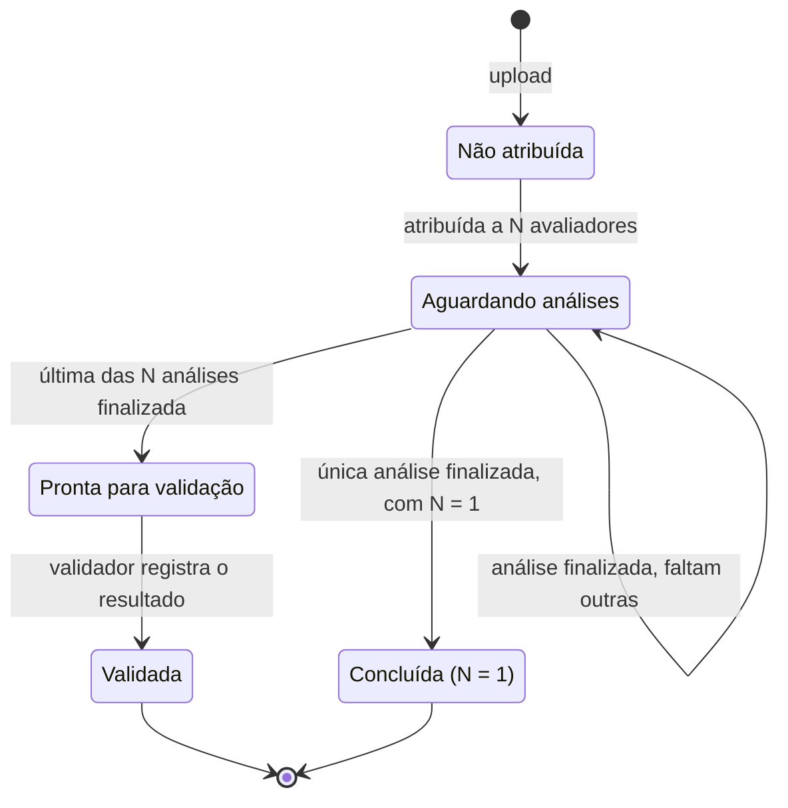

O status da imagem só muda dentro das funções RPC: o app não tem permissão de `UPDATE` na tabela `images`. Na análise, um trigger também recusa reabrir uma análise finalizada (só na fase 2) e voltar uma análise iniciada para pendente.

## 8. Modelo de dados

O esquema completo está em `supabase/schema.sql`. Tabelas e colunas estão em inglês, espelhando os tipos do app; os valores dos enums estão em português. As colunas de autoria (`created_by`, `assigned_by`, `author_id`) também apontam para `profiles`, mas essas ligações ficaram fora do desenho.

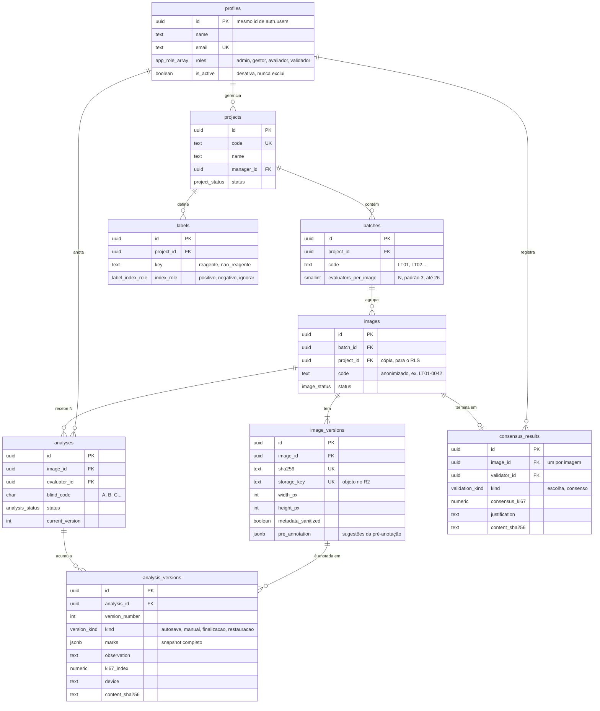

O log de auditoria e os desafios de 2FA:

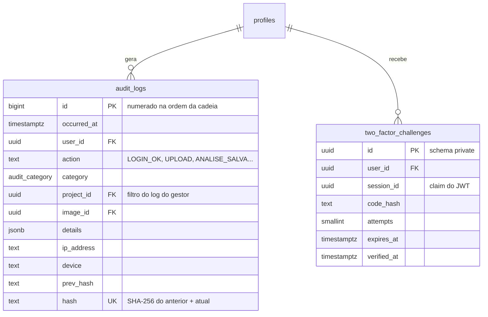

As marcações de cada versão (e a pré-anotação de cada imagem) ficam num JSONB. As coordenadas são **porcentagens da imagem (0 a 100)**, então não dependem de tela nem de zoom; a exportação Labelme converte para pixels da imagem original ([D5](#12-decisões-de-arquitetura)):

```ts
type MarkLabel = 'reagente' | 'nao_reagente';
type Origem = 'manual' | 'pre_anotacao' | 'pre_anotacao_editada';

type AnnotationMark = {
  id: string;
  type: 'point' | 'box' | 'polygon';
  label: MarkLabel;
  isAutoSuggested?: boolean;
  origin?: Origem;
  x: number;               // centro do ponto ou canto da caixa, em %
  y: number;
  width?: number;          // caixa, em %
  height?: number;
  points?: { x: number; y: number }[]; // polígono, em %
  createdAt: string;
};
```

Garantias que o próprio banco impõe:

| Garantia | Como | Requisito |
| --- | --- | --- |
| Uma análise por par (imagem, avaliador) | `unique (image_id, evaluator_id)` em `analyses` | RF-26 |
| Cada imagem recebe exatamente N avaliadores | Trigger que compara a contagem com `batches.evaluators_per_image` | RF-29 |
| Gestor não avalia no próprio projeto | Trigger que compara `evaluator_id` com `projects.manager_id` | RN-07 |
| Versões numeradas e imutáveis | `unique (analysis_id, version_number)` e triggers que recusam `UPDATE`, `DELETE` e `TRUNCATE` | RF-33 |
| Log que ninguém altera | Triggers que recusam `UPDATE`, `DELETE` e `TRUNCATE`, inclusive do admin, e hash encadeado | RF-38 |
| Nada é excluído | Usuários, projetos, lotes, imagens e análises recusam `DELETE`; apagar a conta em `auth.users` também é bloqueado | RN-06, RF-06 |
| Original imutável | `sha256` único e chave do objeto derivada do hash | RF-11 |
| Sem 2FA, sem dados | As políticas RLS exigem desafio verificado para o `session_id` da sessão | RF-02 |

## 9. RPCs e Edge Functions

Não há rotas REST próprias. O app usa as tabelas e views pelo PostgREST (sempre filtradas pelo RLS), as funções RPC abaixo e as Edge Functions. "Gestor" sempre significa o gestor **do projeto** daquele recurso.

**Funções RPC** (`supabase/schema.sql`):

| Função | Quem pode | O que faz | Requisitos |
| --- | --- | --- | --- |
| `my_session` | Qualquer sessão | Perfil, papéis e se o 2FA desta sessão já foi confirmado | RF-02 |
| `verify_two_factor_code` | Sessão com desafio aberto | Confere o código (até 5 tentativas) e libera a sessão | RF-02 |
| `register_login`, `log_event` | Sessão ativa | Registra login e eventos permitidos do app (logout, exportação, sessão expirada...) | RF-37 |
| `verify_audit_chain` | Admin | Recalcula a cadeia de hashes e aponta a primeira quebra | RF-38 |
| `admin_update_user` | Admin | Muda nome, papéis e ativa ou desativa a conta | RF-06, RF-07 |
| `register_image`, `set_pre_annotation` | Gestor | Registra a imagem enviada ao R2 e guarda a pré-anotação | RF-08, RF-11, RF-17 |
| `assign_evaluators`, `assign_evaluators_to_batch` | Gestor | Atribui imagens ou um lote inteiro a N avaliadores | RF-10, RF-29 |
| `open_analysis` | Dono da análise | Abre a análise, com a última versão ou a pré-anotação | RF-18, RF-27, RF-28 |
| `save_analysis_version`, `finalize_analysis`, `restore_analysis_version` | Dono da análise | Salva, finaliza e restaura versões, com conferência da versão base | RF-21, RF-33, RF-34 |
| `validation_queue`, `get_comparison`, `submit_validation` | Validador | Fila, comparação anônima e resultado imutável | RF-30 a RF-32 |

**Views** (com `security_invoker`, então o RLS de quem consulta vale): `v_my_analyses`, `v_project_analyses`, `v_batch_progress` e `v_evaluator_progress`, que alimentam a fila do avaliador, a exportação e o painel do gestor (RF-22 a RF-25, RF-40).

**Edge Functions** (`supabase/functions/`):

| Função | Quem pode | O que faz | Requisitos |
| --- | --- | --- | --- |
| `auth-login` | Público | Limite de 5 falhas por e-mail a cada 15 min, confere a senha, emite e envia o código 2FA | RF-01, RF-02, RNF-06 |
| `auth-resend-2fa` | Sessão sem 2FA | Reenvia o código, respeitando o limite de códigos por 15 min | RF-02 |
| `admin-create-user` | Admin | Cria a conta com papéis e envia o link para a pessoa definir a senha | RF-04, RF-07 |
| `r2-upload-url` | Gestor | Confere lote e duplicidade e devolve a URL de PUT | RF-08, RF-11 |
| `r2-download-url` | Quem pode ver a imagem | Lê a versão com o JWT do usuário (RLS) e devolve URLs de GET de 5 min | RF-28, RNF-06 |

Nenhuma função exclui usuários, projetos, análises, versões ou logs (RN-06).

## 10. Segurança e cegamento

O cegamento (RF-26 a RF-28) é garantido em quatro níveis, do mais externo ao mais interno:

1. **Quem é você.** Sessão do Supabase Auth (JWT de curta duração com refresh token rotativo) que só vale depois do código 2FA. O app encerra a sessão depois de 30 min sem atividade (RF-05).
2. **O que você pode fazer.** O app só lê as tabelas diretamente. As únicas escritas diretas são em perfis, projetos, lotes e labels, coluna por coluna e ainda filtradas pelo RLS. Todo o resto (imagens, análises, versões, validação e log) passa por uma função RPC que confere o papel e o dono.
3. **O que você pode ver.** As políticas RLS filtram cada consulta pelo usuário do JWT: o avaliador só vê as próprias análises, o gestor só os próprios projetos, e o validador só vê imagens prontas que ele não anotou. A comparação entrega as análises como A, B, C, sem nomes. Pedir a análise de outra pessoa devolve **NOT_FOUND**, para não confirmar que ela existe, e grava `ACESSO_NEGADO` no log.
4. **Como provamos.** Os testes do banco (`schema.sql` rodado num PostgreSQL local, com cerca de 90 verificações) cobrem cegamento, WORM, RN-07, RF-29 e a cadeia do log. Levar esses testes para o CI é a próxima etapa.

### O que o app recebe e o que fica no servidor

- O app só tem a **chave pública** (`EXPO_PUBLIC_SUPABASE_PUBLISHABLE_KEY`). Ela não dá acesso a nada além do que o RLS libera para o usuário logado.
- A chave `service_role`, as credenciais do R2 e a chave do Resend ficam **só nos segredos das Edge Functions**, nunca em variáveis `EXPO_PUBLIC_`.
- Funções auxiliares ficam no schema `private`, que o PostgREST não expõe.
- O bucket do R2 é **privado**, sem domínio público: uma imagem só é lida por URL assinada de 5 min, gerada depois de conferir o acesso com o JWT do usuário.
- Antes do upload, o app remove EXIF, GPS e textos embutidos da imagem (RNF-07). O nome original do arquivo não é guardado.

Também valem: no máximo 5 falhas de login e 5 tentativas de código a cada 15 min; mensagens de erro genéricas; HTTPS fora do ambiente local; CORS das funções só para as origens em `APP_ORIGINS`; imagens com `Cache-Control: no-store`; e log com triggers e hash encadeado. As senhas são guardadas pelo Supabase Auth com bcrypt.

### Sessão em cada plataforma

| | Android e iOS | Web |
| --- | --- | --- |
| Sessão (JWT e refresh token) | Cifrada com AES-256; a chave fica no SecureStore (Keychain no iOS, Keystore no Android) e o conteúdo cifrado no AsyncStorage | `sessionStorage`: vale só para a aba aberta e some ao fechá-la |
| Rascunho da análise aberta | AsyncStorage | AsyncStorage (localStorage do navegador) |
| No logout | Encerra a sessão no Supabase e apaga os rascunhos | Encerra a sessão no Supabase e apaga os rascunhos |

Na web, a sessão fica acessível ao JavaScript da página (não há cookie `httpOnly` sem um servidor próprio). O risco é reduzido pelo `sessionStorage`, pelo JWT de curta duração e pela ausência de conteúdo de terceiros no app.

## 11. Bibliotecas e o papel de cada uma

Versões fixadas pelo Expo SDK 58 (`npx expo install` escolhe as compatíveis).

| Biblioteca | Versão | Papel no Ki67 |
| --- | --- | --- |
| Expo SDK | 58 | Toolchain, módulos nativos e build para web, Android e iOS a partir do mesmo código |
| React Native + React Native Web | 0.88 / 0.21 | Componentes nativos no celular e HTML na web |
| Expo Router | 58 | Rotas por arquivo, URLs reais na web e grupos de telas por papel |
| NativeWind + Tailwind CSS | 4.2 / 3.4 | Estilos por classes, iguais aos do protótipo |
| react-native-svg | 15 | Desenha pontos, caixas, polígonos e a lupa sobre a imagem |
| Gesture Handler + Reanimated | 3.3 / 4.7 | Base de gestos do React Navigation; a pinça e o pan do canvas usam o PanResponder do React Native |
| expo-image | 58 | Mostra a imagem da lâmina sem cache em disco (`cachePolicy="none"`) |
| Zustand | 5 | Estado da sessão, dos dados do papel e do editor (marcações, ferramenta, desfazer e refazer) |
| TanStack Query | 5 | Cache e nova tentativa das URLs assinadas das imagens e da comparação do validador |
| @supabase/supabase-js | 2 | Auth, consultas, RPCs e chamadas às Edge Functions |
| expo-secure-store + aes-js | 58 / 3 | Chave da sessão no Keychain e no Keystore, e cifra da sessão |
| AsyncStorage | 2.2 | Rascunho da análise aberta e sessão cifrada |
| expo-document-picker, expo-file-system, expo-sharing | 58 | Escolher as imagens para upload e salvar as exportações |
| expo-crypto | 58 | SHA-256 dos arquivos antes do upload |
| NetInfo | 12 | Estado da conexão para o indicador e o autosave |
| lucide-react-native | 1 | Ícones |
| Supabase (PostgreSQL gerenciado) | PostgreSQL 17 | Banco, Auth, PostgREST e Edge Functions, na região São Paulo |
| aws4fetch | 1.0 | Assina as URLs do R2 dentro das Edge Functions |
| Cloudflare R2 | — | Bucket privado das imagens, compatível com a API S3 e sem cobrança de tráfego de saída |
| Resend | — | Envio do código 2FA por API HTTP (as portas SMTP ficam bloqueadas nas Edge Functions) |
| Jest + jest-expo | 30 / 58 | Testes do índice, dos metadados e da pré-anotação |

## 12. Decisões de arquitetura

| # | Decisão | Por quê | Alternativas descartadas |
| --- | --- | --- | --- |
| D1 | Expo + React Native, com React Native Web no navegador | Uma base para três plataformas (RNF-01), e é a stack da disciplina | Flutter (fora da stack da disciplina); PWA pura (gestos e armazenamento seguro limitados no iOS) |
| D2 | Canvas com `react-native-svg` (revista na v0.4) | Funciona igual na web e no celular sem WebAssembly e roda no Expo Go; o canvas desenha só o que muda | Skia (planejado na v0.3; fica como plano B se a medição com milhares de marcações num celular intermediário mostrar lentidão, RNF-03) |
| D3 | App direto no Supabase: Auth + RLS + RPCs, com Edge Functions só para segredos (revista na v0.4) | Menos uma peça para hospedar e manter no semestre; as regras ficam no banco, que vale até contra o painel do Supabase; o 2FA por e-mail é amarrado ao `session_id` da sessão | API própria em NestJS (plano da v0.3: mais código, mais um servidor e as mesmas regras repetidas em cima do banco); Firebase (NoSQL, sem joins nem triggers) |
| D4 | Cada versão é um snapshot imutável das marcações (JSONB) | Histórico, restauração e diff simples; nada é sobrescrito (RF-33 a RF-35) | Tabela de marcações com `UPDATE` (perde histórico); event sourcing (complexo demais para o prazo) |
| D5 | Coordenadas em % da imagem (revista na v0.4) | O protótipo já usa esse formato; não dependem de tela nem de zoom (RNF-02); a exportação Labelme converte para pixels com as dimensões guardadas em `image_versions` | Pixels da imagem original (exigiria converter em todo o canvas) |
| D6 | Log no próprio PostgreSQL, com triggers e hash encadeado | O somente-inclusão é garantido pelo banco, não só pela aplicação (RF-38) | Arquivo de log no servidor (fácil de editar); serviço externo (custo e dependência) |
| D7 | Imagens no Cloudflare R2, enviadas e lidas direto pelo app com URLs assinadas | Bucket privado, sem cobrança de tráfego de saída, o que importa para imagens grandes abertas várias vezes; o arquivo não passa pelo Supabase | Supabase Storage (concentraria banco e arquivos num só plano gratuito) |
| D8 | Um só pacote de app (`apps/mobile`), com scripts na raiz (revista na v0.4) | Sem API própria, não há código a compartilhar entre pacotes; o índice e a concordância ficam em `src/utils/ki67.ts` | Monorepo com pacote `shared` (planejado na v0.3 para app + API) |
| D9 | Banco PostgreSQL gerenciado no Supabase | PostgreSQL completo, então triggers, permissões e JSONB (D4, D6) continuam valendo; backups, painel e região em São Paulo prontos; plano gratuito para o semestre | PostgreSQL em container próprio (instalação, backup e atualização por conta do grupo) |
| D10 | Pré-anotação calculada uma vez por imagem, no upload, e guardada | Todos os avaliadores recebem exatamente a mesma sugestão, o que permite medir o viés dela (Q2), e abrir a imagem não espera processamento | Calcular no aparelho a cada abertura (resultados diferentes por plataforma e lento no celular) |
| D11 | Papel de gestor do projeto separado do administrador | Quem conduz o estudo organiza o próprio projeto, e o administrador do sistema não precisa ver nenhuma anotação | Administrador fazendo tudo (concentra acesso e não escala para vários estudos) |
| D12 | Pré-anotação calculada no navegador do gestor, no momento do upload | Sem servidor próprio para processar imagens; o canvas do navegador decodifica JPEG e PNG | Edge Function com decodificação de imagem (limite de memória e tempo); serviço separado (mais uma peça para hospedar) |
| D13 | Modo demonstração com dados em memória quando falta o `.env` | As telas podem ser mostradas e testadas sem conta em nuvem, e os dois modos usam os mesmos tipos | Exigir Supabase até para ver as telas |

### Limitações conhecidas

- **Pré-anotação só pela web.** Uploads feitos pelo celular, e imagens TIFF, entram sem pré-anotação (D12).
- **Cópia reduzida.** A coluna `preview_storage_key` existe, mas a cópia reduzida de imagens acima de 4.096 px ainda não é gerada; o app abre o original (RNF-04).
- **Testes do banco fora do CI.** A bateria roda localmente; falta levá-la para o CI com um Supabase local.
- **Medição de desempenho do canvas** com 2.000 marcações num celular intermediário ainda não foi feita (RNF-03).

---

| Versão | Data | Mudança |
| --- | --- | --- |
| 0.1 | 07/10/2026 | Arquitetura inicial: camadas, navegação, sequências, ciclos de vida, dados, API e decisões. |
| 0.2 | 07/10/2026 | Banco passa a ser o Supabase (D9): visão geral, pastas, segurança da Data API e RLS, bibliotecas e D3/D7 revistas. |
| 0.3 | 07/10/2026 | Retorno do professor: papéis de avaliador e gestor (D11), projetos e N avaliadores por lote, pré-anotação no upload (D10), sequência de comparação, imagens no Cloudflare R2 (D7) e COCO removido. |
| 0.4 | 19/10/2026 | Documento alinhado ao código: app direto no Supabase sem API NestJS (D3), canvas SVG (D2), coordenadas em % (D5), um só pacote (D8), pré-anotação no navegador (D12), modo demonstração (D13), RPCs e Edge Functions no lugar das rotas REST, sessão por plataforma e limitações conhecidas. |
