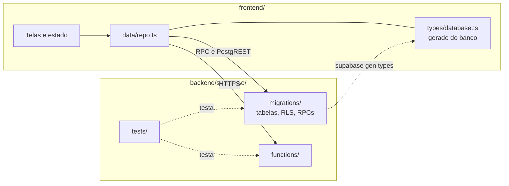
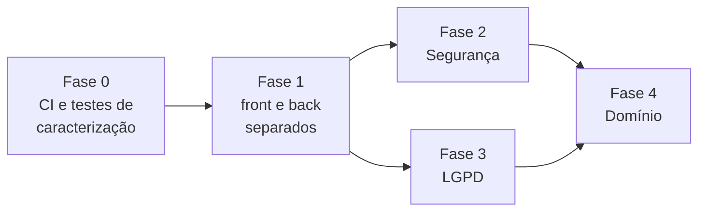

# 05 · Plano de refatoração

> **Documento vivo.** Versão 0.1, de 21/10/2026. Lista o que muda no código depois do MVP, em que ordem e com quais testes. As prioridades são **segurança e LGPD**; o meio é **desenvolvimento guiado por testes**; e o resultado esperado é um repositório com **front e back separados**. Cada tarefa tem um ID (R-01, R-02...) que aparece nos commits e no pull request que a entrega.

**Neste documento:** [1. Por que refatorar](#1-por-que-refatorar) · [2. Regras de trabalho](#2-regras-de-trabalho) · [3. Diagnóstico](#3-diagnóstico) · [4. Estrutura alvo](#4-estrutura-alvo) · [5. Fases e tarefas](#5-fases-e-tarefas) · [6. O que depende de autorização](#6-o-que-depende-de-autorização) · [7. Riscos](#7-riscos)

---

## 1. Por que refatorar

O MVP está implementado (veja [03 · Planejamento](03-planejamento.md#1-marcos-e-entregas)), mas três pontos precisam mudar antes de usar imagens reais do estudo:

1. **Segurança e LGPD.** Algumas garantias dependem só do aparelho do usuário, e o log de auditoria guarda dados pessoais para sempre. Num estudo com dado de saúde, isso é o risco mais alto do projeto.
2. **Testes.** Não há CI. Os testes do banco não estão no repositório, só existem 3 arquivos de teste unitário no app, e as Edge Functions não têm nenhum teste. Sem essa rede, mexer no RLS ou no log é arriscado.
3. **Organização.** O app e o backend dividem a raiz do repositório sem uma fronteira clara, o banco é um único `schema.sql` com patches manuais, e algumas regras de negócio existem nos dois lados.

## 2. Regras de trabalho

Valem as regras de [03 · Planejamento](03-planejamento.md#4-estratégia-de-branches), com três acréscimos.

**Branches e pull requests.** Sem mudança: cada integrante trabalha na própria branch (`Fernando`, `Matheus`...) e entrega por pull request para a `main`. Nada vai direto para a `main`.

**ID da tarefa no commit.** O commit cita o ID da tarefa entre parênteses, como já se faz com os requisitos. Quando o commit também implementa um requisito, os dois aparecem:

```text
test(cegamento): avaliador não lê análise de outro avaliador (R-04)
fix(funcoes): CORS recusa origem sem APP_ORIGINS configurado (R-10)
feat(banco): log de auditoria pseudonimizado (R-17, RF-38)
```

**Teste primeiro (TDD).** Toda tarefa de código segue o ciclo vermelho, verde, refatorar:

1. um commit `test(...)` com o teste que **falha** e mostra o problema ou o comportamento novo;
2. um commit `fix`/`feat`/`refactor` que faz o teste passar;
3. se precisar, um commit `refactor` que limpa o código sem mudar o comportamento.

O revisor vê o problema antes da solução, e o teste fica como guarda contra regressão. Exceções: tarefas só de documentação ou de configuração (`docs`, `ci`, `chore`).

**Nada nos ambientes reais.** Todas as tarefas rodam contra o **Supabase local** (`supabase start`, com Docker) e com o **R2 simulado** nos testes. Nenhuma tarefa deste plano aplica migração, implanta função ou altera configuração no projeto Supabase ou na conta Cloudflare do grupo. Isso fica para um passo à parte, autorizado (veja a [seção 6](#6-o-que-depende-de-autorização)).

## 3. Diagnóstico

Levantamento feito em 21/10/2026 sobre a `main` (commit `d8d3a68`).

### Segurança

| ID | Problema | Onde | Gravidade |
| --- | --- | --- | --- |
| S1 | A remoção de metadados das imagens (EXIF, XMP, textos de PNG e TIFF) roda **só no aparelho**. A URL assinada de envio não amarra o hash, o tamanho nem o tipo do arquivo, então um cliente alterado ou com defeito consegue enviar uma imagem com dados do paciente | `apps/mobile/src/utils/imageMetadata.ts`, `supabase/functions/r2-upload-url` | Crítica |
| S2 | O CORS das Edge Functions libera qualquer origem (`*`) quando `APP_ORIGINS` não está configurado: a falha abre o acesso em vez de fechá-lo | `supabase/functions/_shared/http.ts` | Alta |
| S3 | Sem o `.env`, o app entra em modo demonstração sem avisar no build. Um build de produção mal configurado aceita qualquer código 2FA | `apps/mobile/src/data/mode.ts` | Alta |
| S4 | O limite de tentativas de login conta só por e-mail. Qualquer pessoa consegue bloquear a conta de outra, e não existe limite por IP | `supabase/functions/auth-login` | Média |
| S5 | Na web, a sessão fica no `sessionStorage`, que um script injetado (XSS) consegue ler. Não há política de segurança de conteúdo (CSP) definida para a versão web | `apps/mobile/src/storage/authStorage.ts` | Média |
| S6 | Não há varredura de segredos nem auditoria de dependências no fluxo de pull request | — | Média |

### LGPD

| ID | Problema | Onde | Gravidade |
| --- | --- | --- | --- |
| L1 | O log de auditoria, que não pode ser alterado nem apagado, guarda nome, IP, dispositivo e, nas falhas de login, o **e-mail digitado**, inclusive de quem não tem conta. Esses dados ficam para sempre, o que conflita com a minimização (art. 6º, III) e com a eliminação a pedido do titular (art. 18, VI) | `public.audit_logs`, `log_auth_failure` em `supabase/schema.sql` | Crítica |
| L2 | O prazo de retenção está descrito em [01 · Visão e requisitos](01-visao-e-requisitos.md#8-privacidade-e-lgpd), mas nada no código o aplica | — | Alta |
| L3 | Não há aviso de privacidade com aceite registrado, nem forma de o usuário exportar os próprios dados (art. 18, II e V) | — | Alta |
| L4 | Não existe relatório de impacto à proteção de dados (RIPD, art. 38), recomendado para dado de saúde em pesquisa, nem o registro das operações de tratamento (art. 37) | `docs/` | Alta |

### Testes e organização

| ID | Problema | Onde | Gravidade |
| --- | --- | --- | --- |
| T1 | Não há CI. Os testes do banco rodam só na máquina de quem os escreveu e não estão no repositório. As Edge Functions não têm testes | — | Alta: bloqueia as outras tarefas |
| A1 | O banco é um `schema.sql` de 2.100 linhas, e as atualizações são scripts manuais (`patch_fase4.sql`). Sem migrações versionadas, uma mudança é difícil de revisar, testar e aplicar | `supabase/` | Alta |
| A2 | A fórmula do índice Ki-67 existe no app e no banco. As métricas de comparação rodam só no app, e o "ICC" exibido é uma heurística (`0,98 − 0,04 × Δp.p.`), não um coeficiente de correlação intraclasse | `apps/mobile/src/utils/ki67.ts` | Média |
| A3 | A coincidência espacial mede distância em porcentagem das coordenadas, o que distorce imagens que não são quadradas, e uma mesma marcação pode casar com várias do outro avaliador | `calculateSpatialCoincidence` em `ki67.ts` | Média |

## 4. Estrutura alvo

Front e back passam a ter cada um a sua pasta na raiz, com dependências, testes e scripts próprios. A raiz só orquestra.

```text
ki67/
├── frontend/                 # app Expo (web, Android e iOS), hoje em apps/mobile
│   ├── src/
│   └── package.json
├── backend/
│   └── supabase/
│       ├── migrations/       # o schema.sql vira migrações versionadas
│       ├── functions/        # Edge Functions (Deno)
│       ├── tests/
│       │   ├── database/     # pgTAP: RLS, triggers, RPCs, log
│       │   └── functions/    # Deno test das Edge Functions
│       ├── seed.sql          # só dados sintéticos
│       └── config.toml
├── docs/
├── .github/
│   ├── workflows/            # CI
│   └── pull_request_template.md
└── package.json              # scripts que delegam para frontend/ e backend/
```



**A fronteira é o contrato do banco.** O frontend só conhece as tabelas que pode ler, as RPCs e as Edge Functions. Os tipos de `frontend/src/types/database.ts` passam a ser gerados a partir das migrações, e o CI falha se ficarem desatualizados. Regra de negócio que decide algo (índice oficial, métricas de concordância, permissões) mora no backend; o frontend exibe e pode calcular uma prévia, desde que um teste de contrato garanta o mesmo resultado.

## 5. Fases e tarefas

A ordem importa. A Fase 0 cria a rede de testes. A Fase 1 move as pastas cedo, para que cada um atualize a própria branch com a mudança uma vez só. As Fases 2 e 3 trazem a prioridade máxima. A Fase 4 corrige o domínio.



As Fases 2 e 3 podem andar em paralelo, com integrantes diferentes. Cada linha das tabelas abaixo é **um pull request**.

### Fase 0 · Rede de segurança

Nenhuma mudança de comportamento. O objetivo é fixar o comportamento atual em testes antes de mexer nele.

| ID | Tarefa | Teste que comprova | Commit de exemplo |
| --- | --- | --- | --- |
| R-01 | CI no GitHub Actions em todo pull request: lint, checagem de tipos, Jest e build web | O próprio pipeline verde na `main` | `ci: roda lint, tipos, testes e build no pull request (R-01)` |
| R-02 | Varredura de segredos (gitleaks), `npm audit` e Dependabot | Um segredo falso num commit de teste quebra o pipeline | `ci: varredura de segredos e auditoria de dependências (R-02)` |
| R-03 | Template de pull request (checklist da Definition of Done, IDs de tarefa e requisito), validação das mensagens de commit (commitlint) e CODEOWNERS | Commit fora do padrão é recusado no CI | `chore: template de PR e validação de commits (R-03)` |
| R-04 | Converter `schema.sql` em `supabase/migrations/`, com uma migração base idêntica ao banco atual. `patch_fase4.sql` deixa de ser necessário | No CI, o banco criado pelas migrações tem o mesmo esquema que o criado pelo `schema.sql` (comparação do `pg_dump --schema-only`) | `refactor(banco): schema.sql vira migrações versionadas (R-04)` |
| R-05 | Testes de caracterização em pgTAP, rodando no Supabase local do CI: o RLS de cada papel (avaliador, validador, gestor, admin), o bloqueio sem 2FA, os triggers que impedem alterar versões e log, RN-07, RF-29 e `verify_audit_chain()` | A própria bateria, verde contra o banco atual | `test(cegamento): bateria de RLS por papel (R-05, RF-26 a RF-28)` |
| R-06 | Testes das 5 Edge Functions com `deno test`, com Supabase, R2 e Resend simulados | A própria bateria, verde | `test(funcoes): login, 2FA, usuários e URLs do R2 (R-06)` |

### Fase 1 · Front e back separados

| ID | Tarefa | Teste que comprova | Commit de exemplo |
| --- | --- | --- | --- |
| R-07 | Pull request **só de movimentação** (`git mv`, sem alterar conteúdo): `apps/mobile` → `frontend/`, `supabase/` → `backend/supabase/`. Ajusta scripts da raiz, CI e caminhos nos documentos. Combinado com o grupo para um momento sem outros PRs abertos | CI verde sem mudar nenhum teste | `refactor!: separa frontend/ e backend/ na raiz (R-07)` |
| R-08 | Tipos do banco gerados com `supabase gen types` a partir das migrações; o CI compara com o arquivo versionado | Mudar uma coluna sem regenerar os tipos quebra o CI | `feat(banco): tipos do frontend gerados do banco (R-08)` |
| R-09 | O backend passa a ser a fonte do índice Ki-67: o frontend usa o valor do banco e calcula só a prévia durante a anotação | Teste de contrato: os mesmos casos em Jest e em pgTAP dão o mesmo índice | `refactor(app): índice oficial vem do banco (R-09)` |

### Fase 2 · Segurança

Cada tarefa começa por um teste que reproduz a falha.

| ID | Problema | Tarefa | Teste que comprova (escrito antes) |
| --- | --- | --- | --- |
| R-10 | S2 | CORS fechado por padrão: sem `APP_ORIGINS`, a função recusa requisições de navegador | `deno test`: sem a variável, a resposta não tem `Access-Control-Allow-Origin: *` |
| R-11 | S1 | A URL de envio passa a amarrar `Content-Length`, `Content-Type` e o checksum SHA-256 informado | `deno test`: a URL assinada carrega esses cabeçalhos assinados |
| R-12 | S1 | Envio em duas etapas: o arquivo cai numa área de quarentena; uma função no servidor confere o SHA-256 e o tamanho, refaz a inspeção de metadados e só então registra a imagem e a move para a área definitiva | `deno test`: imagem com EXIF ou com hash diferente do declarado é recusada e não chega a `image_versions` |
| R-13 | S3 | Modo demonstração só com `EXPO_PUBLIC_DEMO=true`. Sem configuração e sem essa variável, o app mostra erro de configuração; o build de produção falha | Jest: sem `.env` e sem a variável, `DATA_MODE` não é `demo` |
| R-14 | S4 | Limite de tentativas também por IP, com espera progressiva e resposta idêntica para conta existente e inexistente | `deno test`: 6ª tentativa do mesmo IP com e-mails diferentes recebe 429; tempo e mensagem iguais com e sem conta |
| R-15 | S5 | CSP e cabeçalhos de segurança (`X-Content-Type-Options`, `Referrer-Policy`, `frame-ancestors`) para a versão web, documentados para a hospedagem | Teste do build web: o HTML gerado tem a CSP e nenhum script em linha fora dela |

### Fase 3 · LGPD

| ID | Problema | Tarefa | Teste que comprova (escrito antes) |
| --- | --- | --- | --- |
| R-16 | L4 | `docs/06-privacidade-lgpd.md`: registro das operações de tratamento, RIPD, base legal, prazos de retenção, operadores (Supabase, Cloudflare, Resend) e transferência internacional | Revisão do grupo; sem teste automatizado |
| R-17 | L1 | Log pseudonimizado: o log guarda só um identificador opaco do titular. Nome, e-mail, IP e dispositivo vão para uma tabela separada, que pode ser anonimizada. A cadeia de hash é calculada sobre o conteúdo pseudônimo | pgTAP: anonimizar um usuário apaga os dados pessoais dele e `verify_audit_chain()` continua íntegro |
| R-18 | L1 | Falha de login registra o hash do e-mail com sal, não o e-mail em texto | pgTAP: depois de uma falha com e-mail inexistente, o e-mail não aparece em nenhuma tabela |
| R-19 | L2 | Retenção automática com `pg_cron`: IP e dispositivo expiram no prazo definido em R-16; códigos 2FA vencidos são apagados | pgTAP: com o relógio adiantado, a rotina remove o que venceu e mantém o resto |
| R-20 | L3 | Aviso de privacidade e termo de uso com versão; o aceite fica registrado no primeiro acesso e quando a versão muda | pgTAP: sem aceite da versão atual, o RLS não libera dados; Jest: a tela de aceite aparece |
| R-21 | L3 | RPC para o usuário exportar os próprios dados (perfil, análises e registros do log sobre ele) e fluxo de anonimização ao fim do vínculo, executado pelo admin | pgTAP: a exportação traz só dados do próprio usuário; a anonimização não quebra versões nem log |

### Fase 4 · Domínio

| ID | Problema | Tarefa | Teste que comprova (escrito antes) |
| --- | --- | --- | --- |
| R-22 | A2 | ICC real, por exemplo ICC(2,1), calculado no backend, no lugar da heurística | Casos com resultado de referência calculado num pacote estatístico (R ou Python) |
| R-23 | A3 | Coincidência espacial em pixels, com pareamento um para um entre marcações | Casos com imagem retangular e com uma marcação perto de duas do outro avaliador |

## 6. O que depende de autorização

Este plano muda só o código do repositório. Ficam **fora** dele, até o grupo autorizar explicitamente:

- aplicar migrações no projeto Supabase real (`supabase db push` ou SQL Editor);
- implantar Edge Functions ou alterar segredos (`supabase functions deploy`, `supabase secrets set`);
- qualquer mudança no bucket, nas chaves ou no CORS do Cloudflare R2;
- ativar `pg_cron` ou mudar configurações do Supabase Auth no projeto real.

Quando uma fase estiver na `main`, a aplicação nos ambientes reais vira uma tarefa própria, com responsável, data e roteiro de volta (rollback), registrada em [04 · Guia de configuração](04-guia-de-configuracao.md).

Também precisa de decisão fora do código: a proteção da branch `main` no GitHub (1 aprovação e CI verde obrigatórios), que só o dono do repositório pode ativar, e as respostas de R-16 que dependem da instituição e do CEP.

## 7. Riscos

| Risco | Impacto | Como reduzimos |
| --- | --- | --- |
| A movimentação de pastas (R-07) conflitar com branches em andamento | Alto | PR só de `git mv`, combinado com o grupo para um momento sem PRs abertos; cada um faz `git pull origin main` logo depois |
| Uma refatoração do RLS abrir um vazamento de cegamento sem ninguém perceber | Alto | Bateria de caracterização (R-05) antes de qualquer mudança no banco; CI obrigatório |
| Pseudonimizar o log (R-17) quebrar a cadeia de hash já gravada | Alto | Migração testada sobre uma cópia com dados sintéticos; `verify_audit_chain()` roda antes e depois no teste |
| Supabase local (Docker) pesado demais para algumas máquinas | Médio | Os testes de banco rodam no CI; localmente, roda só quem mexe no backend |
| O plano competir com as entregas do cronograma de [03 · Planejamento](03-planejamento.md#2-cronograma) | Médio | Fase 0 e Fase 2 primeiro, porque protegem a avaliação; Fase 4 pode ficar para depois do Laboratório de Avaliação |

---

| Versão | Data | Mudança |
| --- | --- | --- |
| 0.1 | 21/10/2026 | Diagnóstico de segurança, LGPD, testes e organização; estrutura alvo com `frontend/` e `backend/`; fases e tarefas R-01 a R-23 com o teste de cada uma. |
