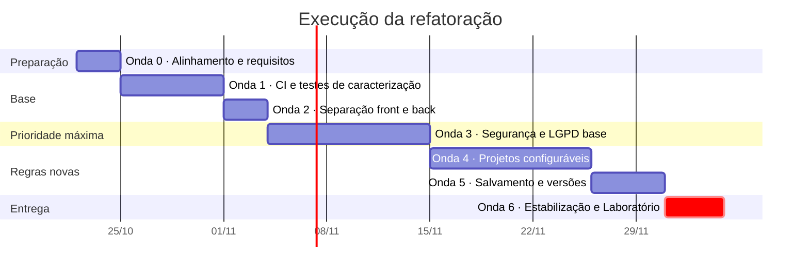
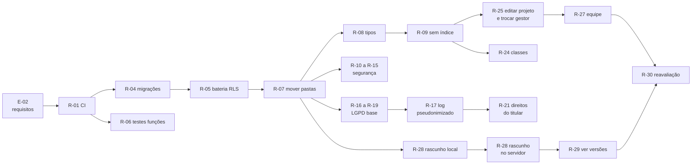

# 06 · Plano de execução da refatoração

> **Documento vivo.** Versão 0.3, de 26/10/2026. O [05 · Plano de refatoração](05-plano-de-refatoracao.md) diz **o que** muda e **por quê** (diagnóstico e tarefas R-01 a R-30). Este documento diz **em que ordem**, **com quais regras de negócio**, **em quantos pull requests** e **quando cada etapa está pronta**. Quando uma data ou uma regra mudar, este arquivo muda no mesmo pull request.

**Neste documento:** [1. Ponto de partida](#1-ponto-de-partida) · [2. Regras de negócio](#2-regras-de-negócio-consolidadas) · [3. Organização do trabalho](#3-organização-do-trabalho) · [4. Ondas](#4-ondas-de-execução) · [5. Dependências](#5-dependências-entre-tarefas) · [6. Linha de corte](#6-linha-de-corte-para-o-laboratório) · [7. Autorizações](#7-portões-de-autorização) · [8. Acompanhamento](#8-acompanhamento) · [9. Riscos](#9-riscos-de-execução)

---

## 1. Ponto de partida

| Onde | O que existe |
| --- | --- |
| `main` | MVP completo em modo demonstração: banco (`supabase/schema.sql`), Edge Functions e telas dos quatro papéis. Sem CI, com 3 arquivos de teste unitário |
| Branch `Fernando` (ainda sem pull request) | Plano de refatoração ([05](05-plano-de-refatoracao.md)) e este plano. O app (`apps/mobile`) está igual ao da `main`: o novo visual "Segmenta" e as imagens de demonstração foram desfeitos, porque as telas não são responsabilidade desta branch |
| Ambientes reais | Projeto Supabase e bucket R2 existem, mas **nada deste plano é aplicado neles sem autorização** ([seção 7](#7-portões-de-autorização)) |

## 2. Regras de negócio consolidadas

As regras abaixo valem para toda a refatoração. As que mudam regras já escritas em [01 · Visão e requisitos](01-visao-e-requisitos.md#9-regras-de-negócio) entram lá na Onda 0, antes de qualquer código.

| ID | Regra | Situação | Tarefas |
| --- | --- | --- | --- |
| RN-01 | Só o admin cadastra usuários, cria e edita projetos e define o **gestor de cada projeto** (um só por projeto), podendo trocá-lo quando quiser. O gestor do projeto sobe e distribui imagens e cuida da equipe | Alterada | R-25 |
| RN-02 | Uma anotação pertence a exatamente um usuário, e ninguém mais pode editá-la | Mantida | R-05 |
| RN-03 | O avaliador só vê as imagens que recebeu e as próprias anotações | Mantida | R-05 |
| RN-04 | Uma análise finalizada só volta a ser editável quando **um gestor do projeto aprova o pedido de reavaliação** feito pelo avaliador. A versão finalizada original fica guardada, e o gestor compara as duas | Alterada (deixa de ser "a confirmar") | R-29, R-30 |
| RN-05 | Uma imagem só vai para comparação depois que as N análises forem finalizadas. Análise em reavaliação conta como não finalizada | Ampliada | R-30 |
| RN-06 | Nenhum registro de log, versão ou análise é apagado | Ampliada (inclui análises) | R-05, R-27 |
| RN-07 | Quem é gestor de um projeto não pode ser avaliador nele | Mantida (vale também ao trocar o gestor) | R-25 |
| RN-08 | Ninguém valida uma imagem que também anotou | Mantida | R-05 |
| RN-09 | Os papéis (Admin, Gestor, Avaliador, Validador) são **globais e fixos**. Só o admin os altera, a qualquer momento, e cada mudança vai para o log | Nova (já é assim hoje, pelo RF-07) | R-05 |
| RN-10 | Cada projeto define as **próprias classes** de marcação, quantas forem necessárias. Admin e gestor do projeto criam, renomeiam, mudam a cor e desativam; nenhuma classe é apagada | Nova | R-24 |
| RN-11 | Renomear ou mudar a cor de uma classe vale também para as marcações antigas, e a mudança aparece **destacada** no registro de atividades do projeto, com o valor antes e depois | Nova | R-24 |
| RN-12 | Só quem está na **equipe do projeto** recebe imagens dele ou valida imagens dele. O gestor do projeto inclui e retira pessoas quando quiser | Nova | R-27 |
| RN-13 | Retirar alguém da equipe **não apaga** as análises dessa pessoa: elas ficam marcadas como "avaliador removido do projeto", e no fechamento a gestão decide, com justificativa, se cada uma conta para o resultado | Nova | R-27 |
| RN-14 | O salvamento automático guarda só um **rascunho**, que sobrevive a fechar e reabrir o app. Uma versão nova só nasce quando o avaliador aperta **Salvar** ou **Finalizar** | Nova (muda RF-21 e RF-33) | R-28 |
| RN-15 | Nesta fase o app **não calcula nem mostra índice** (como o Ki-67): as telas e o fechamento usam a contagem de cada classe | Nova (muda RF-19, RF-31, RF-40) | R-09 |

## 3. Organização do trabalho

**Branches e commits.** Como em [03 · Planejamento](03-planejamento.md#4-estratégia-de-branches): cada integrante na própria branch, pull request para a `main`, Conventional Commits com o ID da tarefa (`test(cegamento): avaliador não lê análise alheia (R-05)`). Nada vai direto para a `main`.

**Um pull request por tarefa.** Cada R-xx é um PR pequeno. Tarefas grandes (R-12, R-17, R-27) podem virar dois PRs: primeiro o banco com os testes, depois a tela.

**Teste primeiro.** Todo PR de código começa com um commit `test(...)` que falha, seguido do commit que o faz passar ([05, seção 2](05-plano-de-refatoracao.md#2-regras-de-trabalho)).

**Três frentes em paralelo.** O grupo distribui os nomes; cada frente tem um responsável e um revisor de outra frente.

| Frente | Cuida de | Tarefas principais |
| --- | --- | --- |
| A · Backend e segurança | Migrações, RLS, RPCs, Edge Functions, testes pgTAP e Deno | R-04 a R-06, R-10 a R-14, R-17 a R-19, R-21, R-24, R-25 e R-27 (banco), R-28 a R-30 (banco) |
| B · Frontend e experiência | Telas, estado, testes com a Testing Library, capturas antes e depois | R-07 a R-09, R-13, R-15, R-24, R-25, R-27 a R-30 (telas) |
| C · LGPD, CI e documentação | Pipeline, documentos, inventário de dados, aviso de privacidade | R-01 a R-03, R-16, R-20, Onda 0, revisão de todo PR de banco |

**Definition of Done de cada PR** (acrescenta à [seção 6 do 03](03-planejamento.md#6-definition-of-done)):

- [ ] Commit de teste que falhava antes da correção
- [ ] CI verde, incluindo a bateria de cegamento (R-05) quando o PR mexe no banco
- [ ] Nenhum segredo no diff (gitleaks verde) e nenhum dado real de paciente
- [ ] Documentos atualizados no mesmo PR (requisito, arquitetura ou este plano)
- [ ] PR de tela traz captura antes e depois, na web e na largura de celular
- [ ] Nada aplicado no Supabase ou no Cloudflare reais

## 4. Ondas de execução

As datas são uma proposta até o [Laboratório de Avaliação](03-planejamento.md#1-marcos-e-entregas) (04/12/2026, *a confirmar*) e substituem as datas das Sprints 1 a 4 do 03 quando o grupo aprovar. Cada onda só começa quando a anterior cumpre o critério de saída.

### Onda 0 · Alinhamento (22 a 24/10)

Nenhum código. Sai daqui a autorização para mudar os requisitos.

| Passo | O que é | Quem |
| --- | --- | --- |
| E-01 | Apresentar ao grupo (e ao professor, se preciso) as mudanças de requisito: índice fora das telas (RN-15), versões só no Salvar (RN-14), reavaliação pedida ao gestor (RN-04), projetos configuráveis (RN-10 a RN-13) | Frente C |
| E-02 | PR de documentação: atualizar em [01](01-visao-e-requisitos.md) os RF-19, RF-21, RF-31, RF-33, RF-40, RF-41, RF-42 e as regras da [seção 2](#2-regras-de-negócio-consolidadas); levar "labels configuráveis" e "reabertura" da Fase 2 para agora; ajustar o cronograma do [03](03-planejamento.md) | Frente C |
| E-03 | PR da branch `Fernando` (planos 05 e 06), revisado por outro integrante | Fernando |
| E-04 | O dono do repositório ativa a proteção da `main`: 1 aprovação e CI obrigatório | Matheus |
| E-05 | Cada integrante: instalar Docker e Supabase CLI para rodar o banco local; tirar segredos do servidor de `apps/mobile/.env` e deixá-los só em `supabase/functions/.env` | Todos |

**Pronta quando:** o PR de requisitos (E-02) está aprovado e a proteção da `main` está ativa.

### Onda 1 · Rede de segurança (25 a 31/10)

| Ordem | Tarefa | Frente | Observação |
| --- | --- | --- | --- |
| 1 | R-01 CI (lint, tipos, Jest, build web) | C | Primeiro PR: tudo depois depende dele |
| 2 | R-02 gitleaks, `npm audit`, Dependabot | C | |
| 2 | R-03 template de PR, commitlint, CODEOWNERS | C | Paralelo ao R-02 |
| 3 | R-04 `schema.sql` vira migrações versionadas | A | Comparação de esquema no CI |
| 4 | R-05 bateria pgTAP do RLS, dos triggers e do log | A | Fixa o comportamento atual; base de todas as ondas seguintes |
| 4 | R-06 testes Deno das Edge Functions | A | Paralelo ao R-05 |

**Pronta quando:** a `main` tem CI verde rodando Jest, pgTAP e Deno a cada PR.

### Onda 2 · Separação front e back (01 a 03/11)

| Ordem | Tarefa | Frente | Observação |
| --- | --- | --- | --- |
| 1 | R-07 mover para `frontend/` e `backend/` (só `git mv`) | B | Janela combinada: nenhum outro PR aberto. Depois todos fazem `git pull origin main` |
| 2 | R-08 tipos gerados do banco | A | |
| 3 | R-09 **revisado**: o fechamento da validação passa a aceitar só contagens; o banco deixa de exigir índice, ICC e divergência, e o app para de calculá-los (RN-15) | A + B | Substitui o "índice vem do banco" do 05, porque o índice saiu |

**Pronta quando:** o repositório tem `frontend/` e `backend/`, e nenhuma tela ou RPC depende de índice.

### Onda 3 · Segurança e LGPD base (04 a 14/11)

Prioridade máxima. As frentes andam em paralelo.

| Frente A (segurança) | Frente C (LGPD) | Frente B (telas) |
| --- | --- | --- |
| R-10 CORS fechado por padrão | R-16 inventário de dados, RIPD e `docs/07-privacidade-lgpd.md` | R-13 modo demonstração só com variável explícita |
| R-11 URL de envio amarrada a tamanho, tipo e hash | R-18 falha de login sem e-mail em texto | R-15 CSP e cabeçalhos da versão web |
| R-12 quarentena e verificação no servidor | R-19 retenção automática | R-28 (parte 1): rascunho local sem criar versão |
| R-14 limite por IP e resposta igual com e sem conta | | |

**Pronta quando:** os problemas S1 a S6 e L1 (parte do e-mail) do [diagnóstico](05-plano-de-refatoracao.md#3-diagnóstico) têm teste verde no CI.

### Onda 4 · Projetos configuráveis (15 a 25/11)

O projeto continua com um único gestor (`manager_id`). A ordem importa: a equipe muda o RLS, e é ela que diz quem pode receber imagens e validar.

| Ordem | Tarefa | Frente | Regras |
| --- | --- | --- | --- |
| 1 | R-25 admin edita o projeto e troca o gestor | A, depois B | RN-01, RN-07 |
| 2 | R-27 equipe do projeto, remoção sem apagar análises, decisão no fechamento | A, depois B | RN-12, RN-13 |
| 2 | R-24 classes por projeto e evento destacado no registro de atividades | A, depois B | RN-10, RN-11 |
| Paralelo | R-17 log pseudonimizado; R-20 aviso de privacidade com aceite; R-21 exportação dos próprios dados | C com A | LGPD |

**Pronta quando:** dá para criar o projeto "Ki67" com duas classes e outro projeto com quatro classes, cada um com sua equipe, e a bateria de cegamento continua verde.

### Onda 5 · Salvamento e versões (26 a 30/11)

| Ordem | Tarefa | Frente | Regras |
| --- | --- | --- | --- |
| 1 | R-28 (parte 2): rascunho também no servidor, para trocar de aparelho | A + B | RN-14 |
| 2 | R-29 ver uma versão anterior sobre a imagem e comparar duas versões | B | RN-04 |
| 3 | R-30 pedido de reavaliação, aprovação do gestor e comparação das duas versões finalizadas | A, depois B | RN-04, RN-05 |

**Pronta quando:** o avaliador fecha e reabre sem perder nada, o histórico só tem versões salvas de propósito, e o gestor vê a diferença entre as duas finalizações de uma análise reavaliada.

### Onda 6 · Estabilização e Laboratório (01 a 04/12)

Sem tarefas novas. Só correção de defeito.

1. Teste num Android e num iPhone de verdade; medição com 2.000 marcações num celular intermediário (RNF-03).
2. **Portão de autorização** ([seção 7](#7-portões-de-autorização)): aplicar as migrações e as funções no ambiente real, seguindo um roteiro com volta (rollback) testado antes num projeto Supabase de teste.
3. Ensaio do roteiro de demonstração com os quatro papéis.
4. Tag `v1.0.0` na `main`.

### Depois do Laboratório

- R-22 e R-23 (ICC e coincidência espacial) ficam **suspensas**: elas só fazem sentido se o índice e as métricas voltarem.
- Índice como opção do projeto, se o grupo decidir trazê-lo de volta.
- Itens da Fase 2 do [01](01-visao-e-requisitos.md#4-escopo-por-fase) que não entraram aqui: aba Em andamento, versionamento de imagens, modo offline completo.

## 5. Dependências entre tarefas

## 6. Linha de corte para o Laboratório

Se o prazo apertar, o grupo corta de baixo para cima. O que está acima da linha precisa estar pronto em 04/12.

| Prioridade | Tarefas | Por quê |
| --- | --- | --- |
| 1 · Obrigatório | Onda 0, R-01 a R-06, R-07, R-09 | Sem testes e sem requisitos aprovados, nada mais é seguro |
| 2 · Obrigatório | R-10 a R-14, R-16, R-18 | Segurança e LGPD são a prioridade máxima do projeto |
| 3 · Obrigatório | R-25, R-27, R-28 (parte 1) | Regras de negócio novas mais visíveis na avaliação |
| — *linha de corte* — | | |
| 4 · Desejável | R-24, R-28 (parte 2), R-29, R-30 | Podem ser mostrados como "em andamento" |
| 5 · Depois | R-15, R-17, R-19 a R-21, R-08 | Importantes, mas com menor risco imediato em ambiente de teste com dados sintéticos |

## 7. Portões de autorização

Nada do que está abaixo acontece sem autorização explícita do grupo, registrada no PR ou na issue correspondente:

| Momento | O que precisa de autorização | Quando |
| --- | --- | --- |
| Fim da Onda 3 | Política de CORS e área de quarentena no bucket R2 | Antes de testar R-11 e R-12 contra o R2 real |
| Fim da Onda 4 | Aplicar as migrações num **projeto Supabase de teste** (não o principal) | Para o ensaio com dados sintéticos |
| Onda 6 | Aplicar migrações, funções e segredos no **projeto principal**; ativar `pg_cron` | Uma vez, com roteiro e volta testados |

Até cada portão, tudo roda no Supabase local (Docker) e com o R2 simulado nos testes.

## 8. Acompanhamento

- **Uma issue por tarefa** no GitHub (E-01 a E-05 e R-01 a R-30, menos a R-26, cancelada), com o critério de pronto e o teste esperado copiados do 05.
- **Um milestone por onda** e uma label por frente (`frente:backend`, `frente:frontend`, `frente:lgpd`).
- O PR fecha a issue (`Closes #N`) e cita a tarefa e as regras (`R-27, RN-12, RN-13`).
- No fim de cada onda, a seção 1 deste documento é atualizada com o que entrou na `main`.

## 9. Riscos de execução

| Risco | Impacto | Como reduzimos |
| --- | --- | --- |
| O professor não aprovar a retirada do índice ou as mudanças de versão | Alto | Onda 0 antes de qualquer código; o índice pode voltar como opção do projeto sem desfazer o resto |
| Seis semanas são pouco para 30 tarefas em um grupo de cinco | Alto | Linha de corte da [seção 6](#6-linha-de-corte-para-o-laboratório); três frentes em paralelo; PRs pequenos |
| A equipe do projeto (R-27) mudar o RLS e abrir uma brecha no cegamento | Alto | R-05 antes; R-27 sozinho num PR de banco, revisado pela frente A e pela frente C |
| Conflitos grandes depois de mover as pastas (R-07) | Médio | Janela combinada, PR só com `git mv`, todos atualizam a branch no mesmo dia |
| Docker e Supabase local pesados para algumas máquinas | Médio | Os testes de banco rodam no CI; quem não consegue rodar localmente fica nas frentes B e C |
| Aplicar no ambiente real só no fim e descobrir problemas na véspera | Alto | Ensaio num projeto Supabase de teste no fim da Onda 4 |

---

| Versão | Data | Mudança |
| --- | --- | --- |
| 0.1 | 21/10/2026 | Regras de negócio consolidadas (RN-01 a RN-15), organização em três frentes, sete ondas até o Laboratório, dependências, linha de corte e portões de autorização. |
| 0.2 | 21/10/2026 | Um único gestor por projeto: R-26 cancelada, troca de gestor no R-25 e regras RN-01, RN-07 e RN-09 ajustadas. |
| 0.3 | 26/10/2026 | O app da branch `Fernando` volta a ser igual ao da `main`: o novo visual e as imagens de demonstração saem do E-03. |
